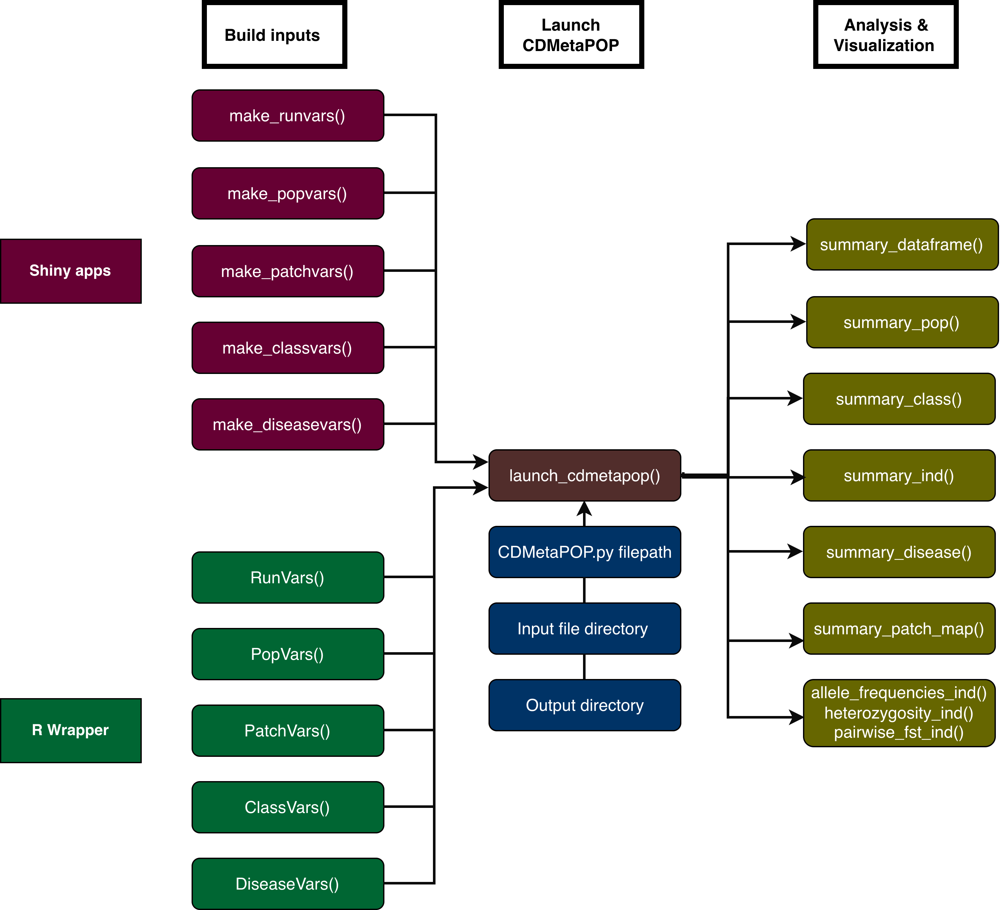

# Summary

This R package is a companion to CDMetaPOP, an individual‑based, spatially explicit population genetics and demography simulation model built on Python architecture [@landguth2017cdmetapop; @day2023cdmetapop]. The package includes (1) five Shiny applications that facilitate the construction of the fundamental input files required by CDMetaPOP, (2) five functions for constructing the same fundamental input files as R objects; (3) a wrapper for launching CDMetaPOP from within R; (4) tools for importing simulation outputs as data frames for custom plotting and analysis; as well as (5) a set of functions for the visualization and analysis of simulation outputs using pre-defined workflows.

# Statement of need

This package is designed to facilitate the use of CDMetaPOP by an audience comprised of researchers across diverse fields, including evolutionary biologists, landscape ecologists, geneticists, and epidemiologists. cdmetapopR provides an R‑based platform for new users interested in applying CDMetaPOP to their own study systems. By offering user‑friendly tools for first‑time implementation, the package lowers the barrier to entry and is expected to promote broader adoption of CDMetaPOP across multiple research disciplines.

# Software design

The package provides two approaches for generating CDMetaPOP input parameter sets: interactive Shiny applications and R wrapper functions. The Shiny applications were developed to increase accessibility for new users and help them become familiar with the format and structure of the CDMetaPOP parameterization. Alternatively, the wrapper functions provide a more efficient and flexible workflow for experienced users that prefer the R coding environment.

Five Shiny applications can be used to construct the four core input files (e.g., make_runvars(); make_popvars(); Figure 1) required by CDMetaPOP, as well as an optional disease module file (make_disease()). Each Shiny app offers a streamlined approach to input‑file creation by guiding users through a series of choices in a graphical user interface, referencing help from the CDMetaPOP manual when needed, and modifying standard default input files based on those selections. Once users have completed their inputs within a Shiny app, they can write the resulting comma-separated values (CSV) files locally and use them to launch CDMetaPOP.

CDMetaPOP is written in Python, and inputs are handled as CSV files. The cdmetapopR wrapper provides an accessible format for working with CDMetaPOP within the R coding environment. The wrapper provides a set of functions that can create input parameter sets and store them as R6 objects, which can then be used to launch simulations using the launch_cdmetapop() function. One function exists for each of the five primary input file types (e.g., RunVars(), PopVars()), and these can be created by reading an existing file from a local path, using default values, or by assigning values for individual parameters. The functions read_cdmetapop() and write_cdmetapop() also provide seamless reading, writing, and converting between CSV files and R objects.

The launch_cdmetapop() function opens a command prompt (Windows) or terminal (Linux/macOS) that calls Python and supplies the five arguments needed to launch CDMetaPOP simulations (Figure 1). Upon launch, the package creates a unique output directory, writes all R6 input objects as the CSV files needed to run the simulation, and returns the output directory file path that can be used to explore outputs with the summary functions. The five arguments accepted by launch_cdmetapop() are: 1) the file path to the Python executable; 2) the file path to the CDMetaPOP.py file; 3) the file path to the base input file directory; 4) the name of the corresponding RunVars file; and 5) the output directory name.

The summary_dataframe() function converts CDMetaPOP output files into data frames, giving the user flexibility to conduct custom plotting and analyses. In addition, five classes of built‑in functions can be used for visualization analysis of CDMetaPOP outputs: 1) summary_pop(), reads and summarizes population demographics extracted from the summary_popAllTime.csv output file; 2) summary_class(), reads and summarizes age and size class dynamics extracted from summary_classAllTime.csv; 3) summary_ind(), conducts analysis at the individual level from ‘ind\*.csv’ output files (e.g., movement/ demographic, histograms of age/size structure dynamics, selection); 4) summary_disease(), analyzes disease dynamics ; and 5) summary_genetics(), summarizes population genetics and structure. These functions are designed to facilitate the analysis of CDMetaPOP output and provide users with rapid, initial insights into their simulations. They handle both in-memory and file-based workflows by accepting either a dataframe or a file path as input. They can also process outputs recursively from multiple directories (e.g., across Monte Carlo replicates or different species), extracting user-specified outcome variables and generating corresponding visualizations (Figure 2).

The package leverages an interactive user interface provided with the use of shiny [@shiny] and shinyBS [@shinyBS] as well as R6 [@R6] for object-oriented class infrastructure. Additionally, several domain-standard R packages are imported for efficient data wrangling and transformation (dplyr [@dplyr] and tidyr [@tidyr], reshape2 [@reshape2]), spatial (terra [@terra], graph4lg [@graph4lg] and gdistance [@gdistance]), population genetic analysis (adegenet [@adegenet], poppr[@poppr]), and visualization (ggplot2 [@ggplot2]).The package integrates with the broader R/CRAN ecosystem, utilizing roxygen2 [@roxygen2] for documentation and unit testing implemented using testthat [@testthat].

# Research impact statement

Spatially explicit, individual-based models (SIBMs) are powerful tools for understanding complex ecological and evolutionary systems, as they allow researchers to simulate the behavior and interactions of individual organisms across space and time. CDMetaPOP is a widely used, open-source SIBM that combines demography and genetics in a spatially explicit framework, making it particularly useful for studying population dynamics, gene flow, selection and adaptation, disease spread, and the effects of landscape features on both real-world and hypothetical animal and plant populations [@landguth2017cdmetapop; @landguth2017plant; @landguth_modeling_2020; @disease; @sullivan_assessment_2026; @beaman2025guide; @lozada_simulation_based_2023; @bernos_simulating_2023; @seaborn_simulating_2023; @seaborn_individual_based_2023; @mendoza_portillo_responses_2023; @day_using_2018; @day2020simulating; @day_evaluation_2021; @day2023cdmetapop; @day2024landscape; @bernos_evaluating_2023; @forester_evolutionary_2023; @escalante_interplay_2018; @nathan_simulation_2019; @mims_simulating_2019; @menon_tracing_2020; @Davenport2026]. This package is designed to make CDMetaPOP more accessible to a wider audience of researchers, including those who may not have extensive experience with Python or command-line interfaces, or prefer working natively within the R environment. By providing user-friendly tools for input file creation and analysis of CDMetaPOP outputs within the R programming language, cdmetapopR aims to promote broader adoption of CDMetaPOP across multiple research disciplines.

# License

GNU General Public License v3.0( GPLv3) (<https://www.gnu.org/licenses/gpl-3.0.html>)

# AI usage disclosure

AI tools used included: OpenAI Codex was used to assist with code generation, debugging, and documentation drafting. All AI-generated code and text were reviewed, modified, tested, and validated by the authors. The authors made all substantive design, implementation, and scientific decisions and take full responsibility for the software and manuscript content.

# Acknowledgements

We acknowledge contributions from Baylor Fain for reviewing the package and providing useful feedback and the University of Montana Computational Ecology Lab (RRID:SCR_029110) for allowing the use of its computational resources. This work was funded by the National Science Foundation grant no. 2407848 and Seattle City Light.

# References

Link to the software archive: <https://doi.org/10.5281/zenodo.19687119>
